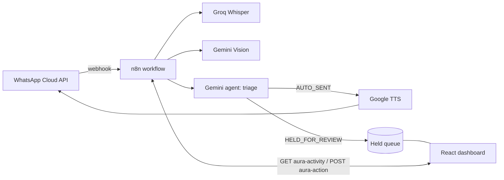

# AURA CONTROL

An AI WhatsApp command center: a dark-mode React dashboard on top of a free, self-hosted n8n backend. Routine messages are answered automatically. Sensitive ones (money, commitments, emotional topics) are held for your approval.


## Features

- **Triage agent:** Gemini 2.0 Flash decides between `AUTO_SENT` and `HELD_FOR_REVIEW` for every message.
- **Multimodal input:** text, voice notes (Groq Whisper `whisper-large-v3`) and images (Gemini Vision).
- **Voice replies:** native WhatsApp voice notes via Google Text-to-Speech (`OGG_OPUS`).
- **Approval queue:** approve, edit or reject held replies from the dashboard.
- **Controls:** Auto-Pilot, Voice Synthesis and Intervention Mode switches that change the workflow's behavior.
- **Voice visualizer:** an animated SVG waveform with idle, listening, processing and speaking states.
- **Demo mode:** the dashboard runs on sample data when no backend is configured.

## Architecture



## Tech stack

React 18, Vite, Tailwind CSS 3, Framer Motion, Lucide icons, n8n, WhatsApp Cloud API, Groq, Google Gemini, Google Cloud Text-to-Speech.

## Project structure

```
aura-control/
├── index.html
├── package.json
├── vite.config.js / tailwind.config.js / postcss.config.js
├── .env.example
├── src/
│   ├── main.jsx
│   ├── index.css
│   └── App.jsx            # dashboard + API calls
└── n8n/
    └── aura-whatsapp-assistant.workflow.json
```

## Quick start (demo mode)

Requires Node.js 18 or newer.

```bash
npm install
npm run dev
```

Open http://localhost:5173. Without a backend URL the dashboard shows sample data.

## Backend setup

1. **Run n8n.** Self-host it, for example with Docker:
   ```bash
   docker run -it --rm -p 5678:5678 -v n8n_data:/home/node/.n8n docker.n8n.io/n8nio/n8n
   ```
   Meta needs a public HTTPS URL. For local use, tunnel it (for example with `cloudflared`) and set `WEBHOOK_URL` to the tunnel address.
2. **Import the workflow.** In n8n choose Workflows, then Import from file, then `n8n/aura-whatsapp-assistant.workflow.json`.
3. **Create credentials** and assign them to the highlighted nodes. The workflow ships with empty credential IDs.

   | Credential | Type | Value |
   |---|---|---|
   | WhatsApp Cloud API Token | Header Auth | `Authorization: Bearer <permanent token>` |
   | Groq API Key | Header Auth | `Authorization: Bearer <key>` |
   | Google API Key | Query Auth | name `key`, with Text-to-Speech and Generative Language APIs enabled |
   | Google Gemini (PaLM) API | Gemini API | key from Google AI Studio |

4. **Set your verify token** in the `Verify Token Valid?` node (replace `aura_verify_token_change_me`).
5. **Activate** the workflow.
6. **Connect Meta.** In the WhatsApp Configuration of your Meta app, set the callback URL to `https://<n8n-host>/webhook/whatsapp`, enter the same verify token, and subscribe to `messages`.
7. **Link the dashboard.** Copy `.env.example` to `.env` and set:
   ```
   VITE_N8N_BASE_URL=https://<n8n-host>/webhook
   ```
   Restart `npm run dev`.

## API reference

| Endpoint | Method | Purpose |
|---|---|---|
| `/webhook/whatsapp` | GET | Meta webhook verification |
| `/webhook/whatsapp` | POST | Incoming WhatsApp messages |
| `/webhook/aura-activity` | GET | Activity log, held items, stats, settings (`?limit=50`) |
| `/webhook/aura-action` | POST | `{action: "approve" \| "edit" \| "reject", id, text?}` or `{action: "set_setting", key, value}` |

Settings keys: `autoPilot`, `voiceSynthesis`, `interventionMode`.

## Security notes

- Never commit `.env` or credentials. `.gitignore` already excludes `.env`.
- Anything in a `VITE_` variable is visible in the browser bundle. Do not put secrets in it.
- The `aura-activity` and `aura-action` webhooks are public by default. Add Header Auth to them, or put them behind a proxy, before sharing the URL.
- Message content passes through Groq, Google and Meta. Review their privacy terms before using real conversations.

## Known limitations

- The held queue and activity log are stored in n8n workflow static data. They persist only while the workflow is active and are not a real database.
- Held messages have no timeout, and the sender sees nothing while a reply is pending.
- The command console and prompt chips only drive the visualizer. There is no backend endpoint for free-text commands yet.
- The Meta temporary token expires after 24 hours. Use a System User permanent token.

## Roadmap

- Auto-acknowledgment for held messages and alerts for stale ones
- Persistent storage (Postgres or Supabase)
- Authenticated dashboard endpoints
- Free-text command endpoint

## License

MIT
